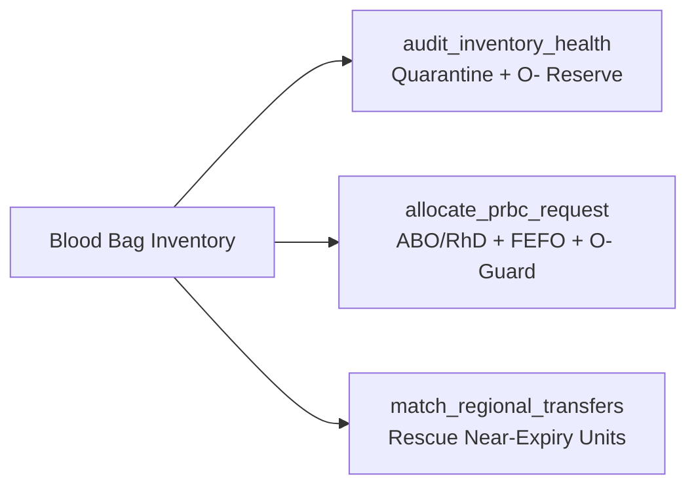

# bloodbank-opt

[](https://github.com/codesphere-u/bloodbank-opt/actions/workflows/ci.yml)
[](LICENSE)
[](pyproject.toml)
[](pyproject.toml)

**Zero-dependency blood-bank transfusion compatibility, O-negative conservation FEFO allocator, PRBC/platelet expiry auditor, and regional hub transfer matcher.**

- **Mission Domain:** Healthcare & Transfusion Supply Chain
- **Stack:** Pure Python 3.11+ (zero runtime third-party dependencies, `mypy --strict`, `ruff`, `pytest`)
- **Maintainer:** Codesphere Innovations (U) Limited (`codesphere-u`)

---

## Problem Solved

Hospitals across Sub-Saharan Africa face acute maternal-hemorrhage blood shortages while simultaneously losing 10–25% of red-cell units to expiry and depleting universal O-negative emergency stock on routine Rh-positive patients.

## Key Features

- Exact ABO/RhD immunohematology rules (`is_rbc_compatible`, `is_plasma_compatible`) covering both Packed Red Blood Cells (`O-` universal donor) and reversed Fresh Frozen Plasma (`AB` universal plasma donor).
- FEFO allocator (`allocate_prbc_request`) enforcing exact-match priority, near-expiry rescue (`<=3d`), and configurable `O-` emergency reserve protection with explicit trauma override.
- Facility expiry/quarantine auditor (`audit_inventory_health`) and regional hub redistribution matcher (`match_regional_transfers`) saving expiring rural clinic units.

## Architecture Overview



See [docs/architecture.md](docs/architecture.md) for module-level design details.

## Installation

```bash
git clone https://github.com/codesphere-u/bloodbank-opt.git
cd bloodbank-opt
uv sync --extra dev
```

Or install in editable mode with standard `pip`:

```bash
pip install -e ".[dev]"
```

## Quick Start (CLI)

```bash
bloodbank-opt inventory.json --facility H1 --as-of 2026-11-25 --request-group A+ --units 2
```

## Quick Start (Python API)

```python
from bloodbank_opt import BloodGroup, is_plasma_compatible, is_rbc_compatible

assert is_rbc_compatible(BloodGroup.O_NEG, BloodGroup.AB_POS)
assert is_plasma_compatible(BloodGroup.AB_POS, BloodGroup.O_NEG) and not is_plasma_compatible(BloodGroup.O_NEG, BloodGroup.A_POS)
```

## Testing & Quality Gates

```bash
uv run ruff check src tests
uv run mypy src
uv run pytest -v
```

## Security, Contributing & Roadmap

- **Security:** See [SECURITY.md](SECURITY.md) for responsible disclosure procedures.
- **Contributing:** See [CONTRIBUTING.md](CONTRIBUTING.md) and [CODE_OF_CONDUCT.md](CODE_OF_CONDUCT.md).
- **Changelog & Roadmap:** See [CHANGELOG.md](CHANGELOG.md) and [ROADMAP.md](ROADMAP.md).

## License

MIT License — see [LICENSE](LICENSE).

## Support & Contact

Open an issue on [GitHub Issues](https://github.com/codesphere-u/bloodbank-opt/issues) or contact `codesphereinnovationz@gmail.com`.
